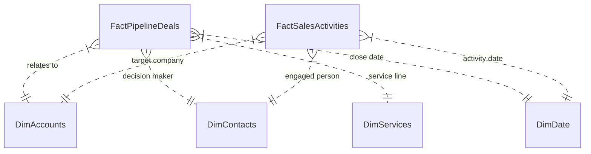

# SECTION 13 — CRM Architecture & Power BI Sales Dashboard
**Zenthra Systems — Internal Business Intelligence Engine**
*Classification: Revenue Operations Analytics & Reporting*

---

## 13.1 CRM Data Model & Entity Relationship Architecture
The Zenthra CRM and analytical database is structured as a star-schema optimized for Power BI ingestion:



### Table Definitions

1. **`FactPipelineDeals`:** `DealID`, `AccountID`, `ContactID`, `ServiceID`, `CreatedDate`, `CloseDate`, `DealStage`, `DealAmount`, `StageProbability`, `LeadSource`, `LostReason`.
2. **`FactSalesActivities`:** `ActivityID`, `AccountID`, `ContactID`, `ActivityType` (Email, LinkedIn, Call, Meeting), `ActivityDate`, `ActivityStatus` (Sent, Opened, Replied, Booked), `OutreachCampaign`.
3. **`DimAccounts`:** `AccountID`, `CompanyName`, `Domain`, `Industry`, `HeadcountBand`, `EstimatedRevenue`, `Country`, `LeadScore`, `QualificationTier`.
4. **`DimContacts`:** `ContactID`, `AccountID`, `FullName`, `JobTitle`, `SeniorityLevel`, `EmailVerificationStatus`, `LinkedInURL`.
5. **`DimServices`:** `ServiceID`, `ServiceCategory`, `PrimaryWedgeName`, `StandardPriceFloor`, `StandardRetainerPrice`.
6. **`DimDate`:** Standard Date dimension supporting Year, Quarter, Month, Week, Day, and Fiscal Periods.

---

## 13.2 Core DAX Measures for Power BI

```dax
// ==========================================
// 1. PIPELINE & DEAL MEASURES
// ==========================================

TotalPipelineValue = 
CALCULATE(
    SUM(FactPipelineDeals[DealAmount]),
    NOT(FactPipelineDeals[DealStage] IN {"Closed Lost"})
)

WeightedPipelineValue = 
SUMX(
    FILTER(
        FactPipelineDeals,
        NOT(FactPipelineDeals[DealStage] IN {"Closed Won", "Closed Lost"})
    ),
    FactPipelineDeals[DealAmount] * FactPipelineDeals[StageProbability]
)

ClosedWonRevenue = 
CALCULATE(
    SUM(FactPipelineDeals[DealAmount]),
    FactPipelineDeals[DealStage] = "Closed Won"
)

OverallWinRate% = 
VAR WonDeals = CALCULATE(COUNTROWS(FactPipelineDeals), FactPipelineDeals[DealStage] = "Closed Won")
VAR TotalClosedDeals = CALCULATE(COUNTROWS(FactPipelineDeals), FactPipelineDeals[DealStage] IN {"Closed Won", "Closed Lost"})
RETURN
DIVIDE(WonDeals, TotalClosedDeals, 0)

AverageContractValue = 
CALCULATE(
    AVERAGE(FactPipelineDeals[DealAmount]),
    FactPipelineDeals[DealStage] = "Closed Won"
)

AverageSalesCycleDays = 
AVERAGEX(
    FILTER(FactPipelineDeals, FactPipelineDeals[DealStage] = "Closed Won"),
    DATEDIFF(FactPipelineDeals[CreatedDate], FactPipelineDeals[CloseDate], DAY)
)

// ==========================================
// 2. LEAD GENERATION & OUTREACH CONVERSION
// ==========================================

TotalAccountsResearched = DISTINCTCOUNT(FactSalesActivities[AccountID])

PositiveReplies = 
CALCULATE(
    COUNTROWS(FactSalesActivities),
    FactSalesActivities[ActivityType] IN {"Email", "LinkedIn"},
    FactSalesActivities[ActivityStatus] = "Replied_Positive"
)

TotalOutreachSent = 
CALCULATE(
    COUNTROWS(FactSalesActivities),
    FactSalesActivities[ActivityType] IN {"Email", "LinkedIn"},
    FactSalesActivities[ActivityStatus] IN {"Sent", "Opened", "Replied_Positive", "Replied_Negative"}
)

PositiveReplyRate% = DIVIDE([PositiveReplies], [TotalOutreachSent], 0)

MeetingsBooked = 
CALCULATE(
    COUNTROWS(FactSalesActivities),
    FactSalesActivities[ActivityType] = "Discovery_Meeting",
    FactSalesActivities[ActivityStatus] IN {"Booked", "Completed"}
)

MeetingBookingRate% = DIVIDE([MeetingsBooked], [PositiveReplies], 0)

// ==========================================
// 3. UNIT ECONOMICS & RECURRING REVENUE
// ==========================================

MonthlyRecurringRetainerRunRate = 
CALCULATE(
    SUM(FactPipelineDeals[RecurringMonthlyValue]),
    FactPipelineDeals[DealStage] = "Closed Won",
    FactPipelineDeals[RetainerActive] = TRUE()
)

CustomerAcquisitionCost = 
VAR TotalSalesSpend = [TotalMarketingToolExpenditure] + [DirectSalesHeadcountCost]
VAR ClientsWon = CALCULATE(COUNTROWS(FactPipelineDeals), FactPipelineDeals[DealStage] = "Closed Won")
RETURN
DIVIDE(TotalSalesSpend, ClientsWon, 0)
```

---

## 13.3 Dashboard Page Layout & Visual Hierarchy

The Power BI report is organized into four purpose-built executive pages:

1. **Page 1: Executive C-Suite Overview (The Cockpit)**
   - Top KPI Ribbon: `ClosedWonRevenue` (MTD & YTD), `WeightedPipeline`, `OverallWinRate%`, `MonthlyRecurringRetainerRunRate`, `AverageSalesCycleDays`.
   - Main Visual (Left): Cumulative Pipeline Waterfall Chart showing deal transitions from *Discovery* $\rightarrow$ *Scoping* $\rightarrow$ *Proposal* $\rightarrow$ *Closed Won*.
   - Main Visual (Right): Clustered Column Chart: Revenue by Service Category (comparing Power BI, AI Automation, GenAI, and Web).
   - Bottom Visual: Geographic Bubble Map showing deal concentration across US, UK, and UAE.

2. **Page 2: Outbound Sales & Campaign Conversion**
   - Funnel Chart: *Accounts Researched* $\rightarrow$ *Contacted* $\rightarrow$ *Positive Replies* $\rightarrow$ *Meetings Booked* $\rightarrow$ *SQOs* $\rightarrow$ *Deals Won*.
   - Matrix Table: Outreach Campaign Performance (Campaign Name, Sent Volume, Open Rate, Positive Reply %, Meeting Rate, Pipeline Generated).
   - Bar Chart: Lead Scores vs. Win Rate correlation.

3. **Page 3: Pipeline Stage Health & Deal Inspection**
   - Active Deals Matrix grouped by Stage and Owner, highlighting deals stalled >14 days in conditional red formatting.
   - Decomposition Tree: Analyzing primary loss reasons (*LostReason* broken down by Service Line and Competitor Type).

4. **Page 4: Unit Economics & Retainer Cohort Analytics**
   - Area Chart: Cumulative Recurring Monthly Retainers (MRR) compounding over time.
   - KPI Cards: Estimated LTV, Blended CAC, LTV:CAC Ratio, Average Payback Period (Days).
